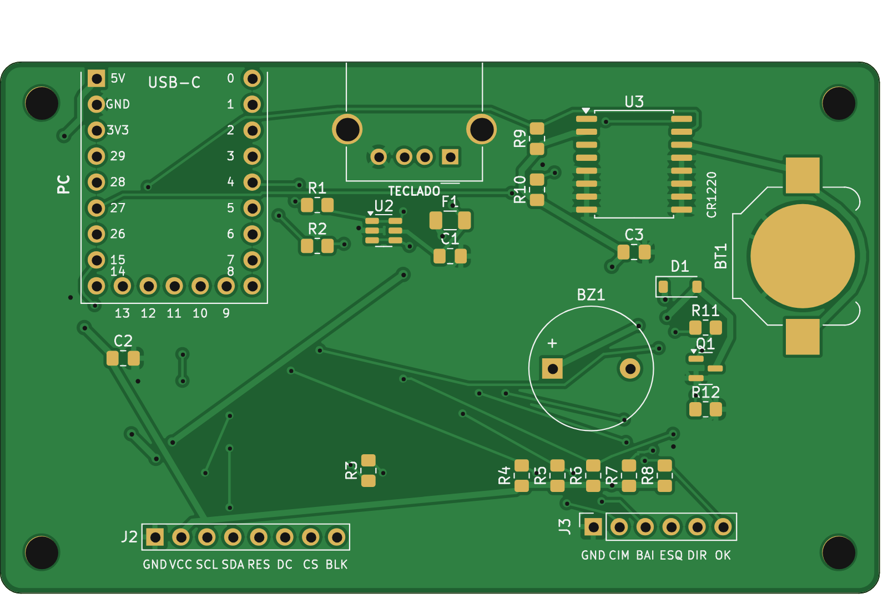

# RP2040 HID Remapper & System Monitor v3 ⌨️📺

Este projeto transforma um **Raspberry Pi Pico (RP2040 ou RP2350)** num intermediário entre o teclado USB e o PC. O teclado físico é ligado no Pico, e o Pico se apresenta ao PC como teclado + teclas de mídia + mouse. No caminho, ele remapeia atalhos, conta e analisa a digitação e mostra tudo num display TFT colorido de 160x80. Um joystick de 5 botões controla o menu.

<p align="center">
  
</p>

## 🆕 Novidades da versão 3

**Correções**
- Menu: agora todos os itens dos submenus podem ser editados. Antes, só o primeiro de cada submenu funcionava.
- A contagem de setas, F8–F12, teclado numérico e `\` estava errada (deslocamento de bits ≥ 64) e foi corrigida.
- Fim das teclas "presas" no PC: os reports passam por uma fila e nenhum é descartado quando o USB está ocupado.
- Os dois núcleos não usam mais a mesma pilha USB ao mesmo tempo, o que podia travar o dispositivo.
- Os LEDs (Caps/Num Lock) são reaplicados quando o teclado é reconectado, e a desconexão do teclado agora é detectada.
- Remapeamento estável: soltar o AltGr antes do R não digita mais um "r".
- Screensavers sem desenho duplicado, sem cintilação e com as bolas sem acelerar até sumir. O Game of Life reinicia quando estabiliza.
- "Intervalo" do anti-bloqueio e "Brilho" passaram a funcionar. O escurecimento automático foi implementado.
- Configurações gravadas com versão + CRC, e só ao sair do menu (menos desgaste da flash e menos pausas no USB).
- Watchdog: se algo travar, o dispositivo reinicia sozinho.

**Novas funções**
- Páginas no monitor: Principal, Estatísticas, Top teclas, Pomodoro e Relógio.
- Total de teclas guardado na flash, contagem do dia, KPM (teclas por minuto) e recorde.
- Ranking das teclas mais usadas.
- Indicadores de Caps Lock e Num Lock na tela.
- Pomodoro, lembrete de pausa (prevenção de LER) e buzzer opcional.
- Camada Fn: com Caps Lock segurado, H/J/K/L viram setas, 1–0 viram F1–F10, etc.
- Macros: um atalho digita um texto.
- Relógio: ajuste pelo menu ou módulo RTC DS3231 opcional.
- Novos screensavers: Pong, Estrelas em dobra espacial, foguetes nos Fogos e Relógio.
- Menu com auto-repetição acelerada, barra de rolagem, confirmação para ações perigosas e fechamento automático.
- "Modo gravação": entra no BOOTSEL pelo menu, sem precisar apertar o botão da placa.
- Testes automáticos da lógica do teclado, que rodam no PC (`test/host`).

## 🎮 Controles

| Onde | Botão | Ação |
|---|---|---|
| Monitor | **OK** | Abre o menu |
| Monitor | **← / →** | Troca de página |
| Página Pomodoro | **↑ / ↓** | Inicia/pausa · zera |
| Screensaver / tela escurecida | qualquer | Só acorda a tela |
| Menu | **↑ / ↓** | Move (segure para repetir) |
| Menu | **OK / →** | Entra · edita · liga/desliga · confirma |
| Menu | **←** | Volta (na raiz, fecha o menu) |
| Editando valor | **↑ / ↓** | Altera (segure para acelerar) |
| Editando valor | **OK / ← / →** | Termina a edição |

O menu fecha sozinho após 30 s sem uso e só grava na flash se algo mudou.

## 📋 Menu

```
CONFIGURACOES
├─ Screensaver   Tipo (lista) · Iniciar apos (min, 0 = nunca) · Trocar a cada (s)
│                Velocidade · Asteroides · Cores (%)
├─ Tela          Brilho · Brilho ocioso · Escurecer apos (s) · Girar 180
├─ Produtividade Anti-bloqueio · Intervalo (s) · Pomodoro >/|| · Pomodoro zerar
│                Foco (min) · Pausa (min) · Lembrete pausa (min, 0 = off)
├─ Teclado       Remapear · Camada Fn · Sinc. volume · Volume inicial
├─ Relogio       Hora · Minuto
├─ Estatisticas  Zerar sessao · Zerar tudo
├─ Sistema       Sobre · Reiniciar · Restaurar padrao · Modo gravacao
└─ Sair
```

## 🚀 Funcionalidades

### Teclado
- **Remapeamentos** (tabela em `keymap.cpp`):
  - `AltGr + R` → `\`
  - `AltGr + M` → `Ctrl + Shift + M` (microfone do Teams)
- **Macros:** um atalho digita um texto. Para criar uma, descomente o exemplo em `keymap.cpp`. Aceita letras, números, espaço, Enter, Tab e `. , - _ = + ! @ # $ % & * ( )`, que ficam na mesma posição no ABNT2 e no US.
- **Camada Fn** (desligada por padrão; ative em *Teclado > Camada Fn*). Segurando **Caps Lock**:
  - H/J/K/L → setas
  - Y/O → Home/End
  - U/N → PgUp/PgDn
  - Backspace → Delete
  - 1…0, -, = → F1…F12

  Um toque rápido no Caps Lock continua ligando e desligando o Caps.
- O teclado e o encoder de volume são lidos pelo descritor HID, o que deve servir para mais modelos de teclado.

### Monitor (páginas ← / →)
1. **Principal:**
   - Teclas de hoje (ou da sessão, se a hora não estiver ajustada)
   - KPM e gráfico dos últimos 60 s com escala automática
   - Barra de volume (e aviso de "MUDO")
   - LEDs Caps/Num, hora e barra de progresso do Pomodoro
2. **Estatísticas:** sessão, hoje, total (guardado na flash), KPM e recorde, tempo digitando e tempo ligado.
3. **Top teclas:** as 5 teclas mais usadas desde sempre. Só a quantidade de cada tecla é guardada, nunca a ordem do que foi digitado.
4. **Pomodoro:** contagem regressiva, fase (foco/pausa) e ciclos.
5. **Relógio.**

### Produtividade
- **Anti-bloqueio:** sem digitação pelo intervalo configurado, move o mouse 1 px e volta.
  > ⚠️ Em computadores corporativos, impedir o bloqueio de tela pode contrariar a política de segurança. Use com responsabilidade; a opção pode ser desligada.
- **Pomodoro** com alertas na tela (e no buzzer, se instalado).
- **Lembrete de pausa:** avisa depois de X minutos de digitação contínua. Cinco minutos sem digitar contam como pausa.

### Screensavers
Atari (arco-íris), Bolas, Pong, Asteroides, Estrelas, Vida (Game of Life), Matrix, Pac-Man, Fogos, Aquário, Relógio, ou **Todos** (rotação automática).

### Relógio ⏰
O dispositivo **não consegue obter a hora do PC sem um programa rodando no PC**, porque o protocolo de teclado/mouse (HID) não transporta data e hora. Por isso há duas opções:
1. **Ajuste manual** em *Menu > Relogio*. A hora é mantida enquanto o dispositivo estiver energizado; se ele for desligado da USB, é preciso ajustar de novo.
2. **Módulo RTC DS3231** (opcional, barato, com bateria CR2032). É detectado sozinho no boot e mantém a hora mesmo desligado. Ao ajustar a hora pelo menu, o módulo também é atualizado.

## 🛠️ Hardware

### Placa de circuito impresso (KiCad)

A pasta [`hardware/`](hardware/README.md) tem o projeto KiCad completo de uma placa-base para o **Waveshare RP2350-Zero** (ou RP2040-Zero). Ela inclui:
- USB-A do teclado com fusível e proteção ESD;
- soquete do LCD e do joystick;
- RTC DS3231 com bateria;
- buzzer.

Também traz os Gerbers prontos para encomendar, a lista de componentes e o esquemático em PDF.

<p align="center">
  
</p>

### Componentes

- **Microcontrolador:** RP2040 (testado no Waveshare RP2040-Zero) ou RP2350 (Waveshare RP2350-Zero).
- **Display:** TFT ST7735 0,96" 160x80 (SPI).
- **USB host:** conector USB-C/A para o teclado via PIO-USB.
- **Joystick de 5 botões** (4 direções + OK), com o pino comum no GND.
- *Opcional:* módulo RTC DS3231 e buzzer passivo.

### Pinagem

| Componente | GPIO | Observação |
|---|---|---|
| TFT_MISO | 12 | configurado no TFT_eSPI |
| TFT_MOSI (SDA) | 11 | |
| TFT_SCLK (SCL) | 10 | |
| TFT_CS | 13 | |
| TFT_DC | 14 | |
| TFT_RST | 15 | |
| **TFT_BLK** | **7** | Para o brilho funcionar. Ligado no 3V3, o brilho fica sempre no máximo (nesse caso use `PIN_BACKLIGHT -1`). |
| USB Host D+ | 0 | |
| USB Host D- | 1 | sempre D+ + 1 |
| USB VCC / GND | 5V / GND | |
| JOY_UP | 2 | |
| JOY_DOWN | 3 | |
| JOY_OK | 4 | |
| JOY_RIGHT | 5 | |
| JOY_LEFT | 6 | |
| RTC SDA *(opcional)* | 26 | I2C1 |
| RTC SCL *(opcional)* | 27 | I2C1 |
| Buzzer *(opcional)* | 8 | via transistor; `PIN_BUZZER` em `config.h` (-1 = sem buzzer) |

Todos os pinos (exceto os do display) ficam em **`config.h`**.

## 💻 Como compilar

1. Instale o core **Raspberry Pi Pico/RP2040/RP2350** (Earle Philhower) no Arduino IDE.
2. Bibliotecas:
   - [Pico-PIO-USB](https://github.com/sekigon-gonnoc/Pico-PIO-USB): USB host via PIO
   - [TFT_eSPI](https://github.com/Bodmer/TFT_eSPI): use um *User_Setup* para ST7735 160x80 (ex.: `Setup43_ST7735.h`) com os pinos da tabela acima
   - O Adafruit TinyUSB já vem com o core.
3. Em *Ferramentas*:
   - **Placa:** Waveshare RP2350 Zero (ou Waveshare RP2040 Zero)
   - **CPU Speed:** **120 MHz** (múltiplo de 12 MHz, exigido pelo USB host). No RP2350 o padrão é 150 MHz, que **não funciona**. Com um clock inválido, a tela mostra um erro explicando.
   - **USB Stack:** Adafruit TinyUSB
4. A pasta do projeto precisa ter o **mesmo nome do `.ino`**: `KBD_COLOR_16_MENU`.
5. Grave e conecte o teclado na porta USB host.

Para atualizar o firmware depois, use *Menu > Sistema > Modo gravacao* e copie o `.uf2` para a unidade `RPI-RP2`.

## 🧩 Estrutura do código

| Arquivo | Função |
|---|---|
| `KBD_COLOR_16_MENU.ino` | Só chama `app_*` (core 0) e `bridge_*` (core 1) |
| `config.h` | Pinos e opções de hardware |
| `usb_bridge.*` | **Core 1:** USB host, remapeamento, camada Fn, macros, fila de envio ao PC, LEDs |
| `shared.*` | Filas entre os núcleos (sem travas) |
| `keymap.*` | Tabelas de remapeamento, macros, camada e nomes das teclas |
| `app.*` | **Core 0:** lógica principal, anti-bloqueio, volume, alertas, watchdog |
| `ui.*` | Páginas do monitor, alertas e avisos |
| `menu.*` | Menu orientado a dados |
| `screensavers.*` | Screensavers numa tabela (adicionar um = uma linha) |
| `settings.*` | Preferências e armazenamento na flash (versão + CRC) |
| `stats.*` | Contagem, KPM, ranking de teclas |
| `pomodoro.*`, `clock.*`, `buttons.*`, `display.*` | Pomodoro, relógio/RTC, joystick, display/cores |
| `test/host/` | Testes que rodam no PC (`make`) |

## 🧪 Testes

A lógica do teclado (remapeamento, camada Fn, macros, fila sem perda, LEDs, mídia) e as estatísticas têm testes que rodam no PC, sem hardware:

```
cd test/host
make
```

## ⚠️ Limitações conhecidas

- **Volume:** o PC não informa o volume por HID. No boot, o volume do PC é levado a um valor conhecido (*Teclado > Volume inicial*), e a barra acompanha o encoder do teclado. Mudanças feitas pelo próprio PC não aparecem.
- **Hora:** veja a seção do relógio. Sem o RTC, a contagem "hoje" recomeça quando o dispositivo é desligado. O total e o ranking ficam na flash.
- Teclados no modo *boot* (6 teclas simultâneas) são suportados. Teclados que só funcionam em NKRO podem precisar estar no modo 6KRO.
