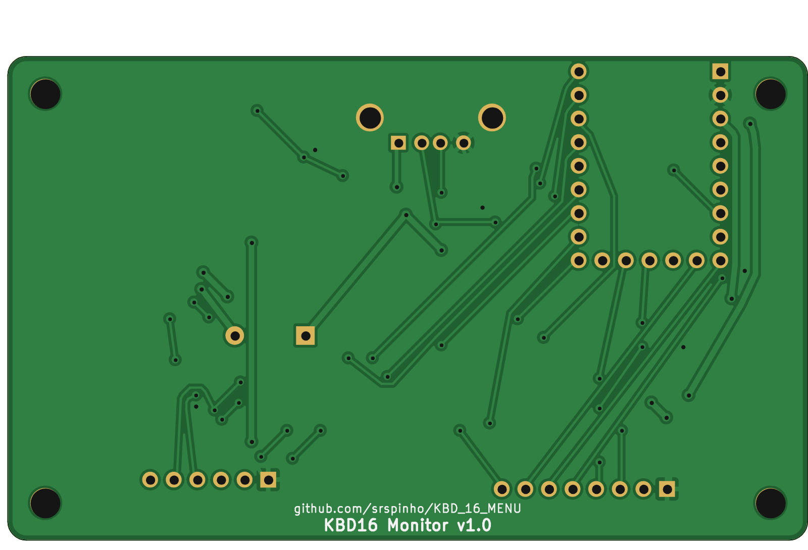

# Placa KBD16 (KiCad)

Placa-base para o **Waveshare RP2350-Zero**, que também aceita o **RP2040-Zero** (mesma pinagem). Ela junta numa só placa:

- a porta USB-A do teclado, com proteção;
- o LCD 0,96" 80x160;
- o joystick de 5 vias;
- o relógio RTC, com bateria;
- o buzzer.

A pinagem é a mesma do firmware (`config.h`), então não é preciso mudar nada no código.

| Frente | Verso |
|---|---|
|  |  |

- **Tamanho:** 86 × 52 mm, 2 camadas, cantos arredondados, 4 furos M3.
- **Regras:** trilhas de 0,25 mm (sinais) e 0,4–0,6 mm (alimentação), folga de 0,2 mm, vias de 0,8/0,4 mm. Qualquer fábrica comum (JLCPCB, PCBWay etc.) fabrica sem custo extra.
- **Planos de GND** nas duas camadas.
- **DRC** (verificação de regras do KiCad): sem erros e sem conexões faltando. Os únicos avisos são da serigrafia do USB-A, que fica para fora da borda de propósito.
- **Esquemático e PCB sincronizados** (verificado automaticamente).

## Arquivos

| Arquivo | Conteúdo |
|---|---|
| `kbd16.kicad_pro` / `.kicad_sch` / `.kicad_pcb` | Projeto KiCad (abre no KiCad 7 ou 8) |
| `lib/` | Símbolo e footprint do RP2350-Zero e footprint do soquete do LCD |
| `fab/kbd16_gerbers.zip` | **Gerbers + furação: é o arquivo que se envia para a fábrica** |
| `fab/kbd16_bom.csv` | Lista de componentes |
| `fab/kbd16_esquematico.pdf` | Esquemático em PDF |
| `fab/kbd16_posicao.csv` | Posição dos componentes (só para montagem pela fábrica) |
| `img/` | Imagens da placa |
| `tools/` | Scripts que geram tudo a partir de `tools/design.py` |

## Ligações (iguais às do firmware)

| Função | GPIO | Na placa |
|---|---|---|
| USB host D+ / D- (teclado) | GP0 / GP1 | J1 (USB-A), via R1/R2 (22 Ω) e proteção ESD U2 |
| Joystick cima / baixo / OK / dir / esq | GP2 / GP3 / GP4 / GP5 / GP6 | J3, com pull-ups de 10 kΩ (R4–R8) |
| Backlight do LCD (BLK) | GP7 | J2 pino 8, via R3 (100 Ω) |
| Buzzer | GP8 | Q1 + BZ1 (alimentado em 5 V) |
| LCD SCL / SDA / CS / DC / RES | GP10 / GP11 / GP13 / GP14 / GP15 | J2 |
| RTC SDA / SCL (I2C1) | GP26 / GP27 | U3 (DS3231), pull-ups de 4,7 kΩ |
| Livres | GP9, GP12, GP28, GP29 | (expansão futura) |

O 5 V do teclado sai do pino 5V do módulo (que vem do USB-C do PC) e passa pelo fusível rearmável F1 (500 mA).

## Montagem

Ordem sugerida, do componente mais baixo para o mais alto:

1. **SMD:**
   - resistores e capacitores 0805 (ilhas maiores, próprias para solda manual);
   - U2 (SOT-23-6), Q1 (SOT-23), D1 (SOD-123), F1 (1206);
   - U3 (SOIC-16), se for usar o RTC.
2. **Suporte da bateria BT1** (CR1220), se for usar o RTC.
3. **Barras fêmea:**
   - para o módulo: 2× 1x9 nas laterais e 1× 1x5 na fileira de baixo (GP9–GP13);
   - J2 (1x8) para o LCD;
   - J3 (1x6) para o joystick.

   Se preferir, solde o módulo direto na placa com barras macho, sem as fêmeas.
4. **USB-A J1 e buzzer BZ1** (THT).
5. **Módulo RP2350-Zero** com o USB-C virado para a borda de trás, onde está escrito *USB-C*.
6. **LCD:** encaixe no J2 com o display para cima, cobrindo a área marcada. A ordem dos pinos está na serigrafia: `GND VCC SCL SDA RES DC CS BLK`.

As partes opcionais podem ficar de fora sem afetar o resto:

| Opcional | Peças | Sem ela |
|---|---|---|
| **RTC** | U3, BT1, C3, R9, R10 | A hora é ajustada pelo menu e se perde ao desligar |
| **Buzzer** | BZ1, Q1, R11, R12, D1 | Os alertas aparecem só na tela |

> Se montar o U3, coloque a bateria: o DS3231 não deve ficar com o pino VBAT solto.

## ⚠️ Confira antes de encomendar

Alguns dados vieram de bibliotecas e fichas genéricas e não dá para confirmar sem as peças na mão. Imprima o PDF da placa em escala 1:1 e encoste as peças no papel:

1. **Módulo RP2350-Zero:** posição dos furos. A fileira de baixo (GP9–GP13) fica na mesma linha dos últimos pinos laterais.
2. **LCD:** a ordem dos 8 pinos do seu módulo (alguns fabricantes trocam) e o tamanho. O contorno de 30 × 24 mm é aproximado e está desenhado na camada F.Fab.
3. **Joystick:** a placa tem uma barra 1x6 na ordem `GND CIMA BAIXO ESQ DIR OK`. Ligue o comum do seu joystick no GND e cada direção no pino correspondente.
4. **USB-A:** footprint do Molex 67643 (THT horizontal, abas a 13,1 mm). A maioria das "USB-A fêmea 90° DIP" genéricas é compatível, mas confira as abas.

## Como encomendar

1. Envie `fab/kbd16_gerbers.zip` para a fábrica (ex.: JLCPCB → *Add gerber file*).
2. Opções:
   - 2 camadas, FR-4, 1,6 mm;
   - qualquer cor de máscara;
   - HASL (com ou sem chumbo).
   As demais podem ficar no padrão.
3. Os componentes estão em `fab/kbd16_bom.csv`. Todos são comuns: LCSC, Mouser, AliExpress etc.

## Firmware

- **Placa:** Waveshare RP2350 Zero.
- **USB Stack:** Adafruit TinyUSB.
- **CPU Speed: 120 MHz.** O padrão do RP2350 (150 MHz) **não funciona** com o USB host. Se esquecer, o firmware mostra um aviso na tela.
- O buzzer já está configurado no GP8 (`PIN_BUZZER` em `config.h`).

## Alterar a placa

Tudo é gerado a partir de `tools/design.py` (componentes, ligações e posições):

```
cd hardware/tools
python3 build_all.py
```

O script refaz em sequência:
- a biblioteca e o esquemático;
- a conferência entre os dois;
- a PCB e o roteamento;
- o DRC;
- os arquivos de fabricação e as imagens.

Ele precisa do KiCad 7 (`kicad-cli` e o módulo Python `pcbnew`); as imagens usam Node + Playwright e são opcionais.

O roteamento é feito por um roteador próprio e simples (`tools/router.py`, A* em grade). Se preferir, abra a placa no KiCad e refaça trilhas à mão: a partir daí, edite direto no KiCad em vez de rodar os scripts de novo.
